# GPU Screen Recorder for OpenDeck

An [OpenDeck](https://github.com/nekename/OpenDeck) plugin that puts
[GPU Screen Recorder](https://git.dec05eba.com/gpu-screen-recorder/about/) on a
Stream Deck: the replay buffer, the recording and the stream visible on the
keys without leaving the game, and one physical key that saves the buffer.

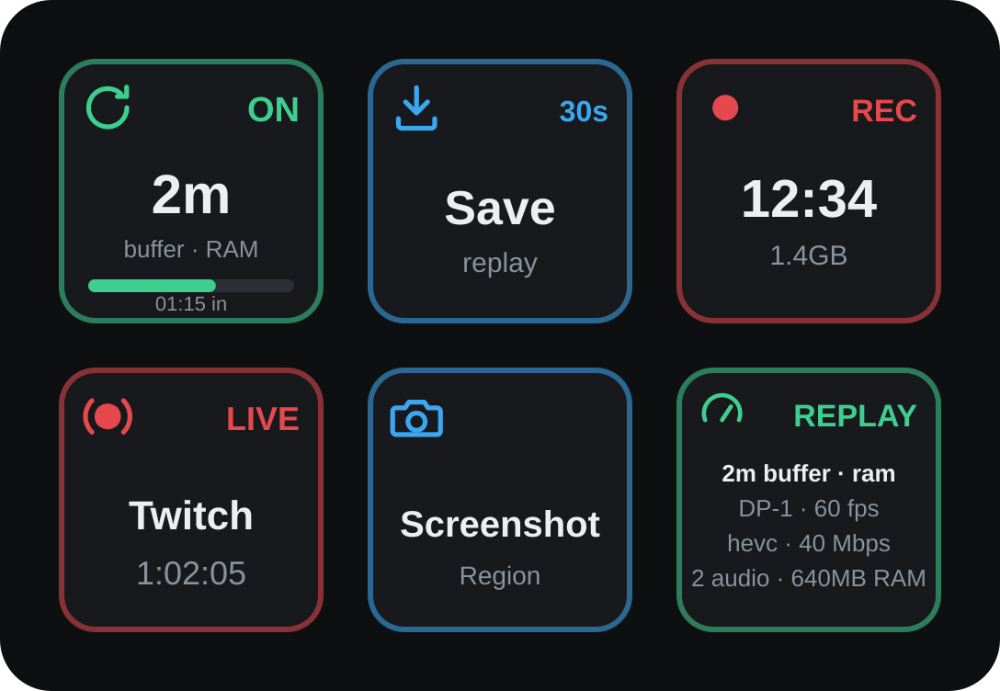

Linux only, Python only, no dependencies — it runs against whatever `python3`
the distribution ships.

## Actions

| Action | What the key shows | What pressing it does |
| --- | --- | --- |
| **Replay** | Whether the buffer is running, how long it is, which storage it uses, and how full it is while it is still filling | Starts or stops the replay (settable to start-only or stop-only) |
| **Save Replay** | How much it will save, and the name of the file it just wrote | Saves the buffer — whole, or the last 10s / 30s / 1m / 5m / 10m / 30m |
| **Save Section** | `MARK`, or the time since the mark and how much a save will be | First press marks a start, second saves the replay from the mark to now |
| **Record** | `REC` with elapsed time and the file's size, or `PAUSED` | Starts or stops a recording, including one inside a running replay; can be set to pause instead |
| **Stream** | `LIVE`, the service, and how long it has been up | Starts or stops streaming |
| **Screenshot** | The area it captures and the last file written | Takes a screenshot of the screen, a region or a window |
| **Status** | Mode, monitor, frame rate, codec, bitrate, audio tracks and the buffer's RAM | Nothing. It is a readout, on purpose |

Every key draws itself from live state, so a replay started from the overlay's
hotkey shows on the deck without the deck being touched.

### What the keys look like

| Action | States | |
| --- | --- | --- |
| **Replay** | 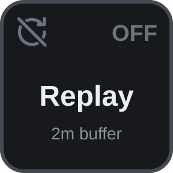 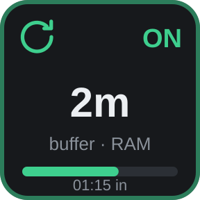 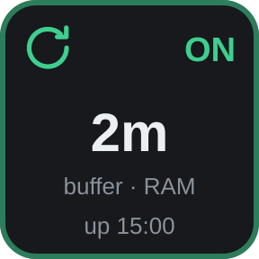 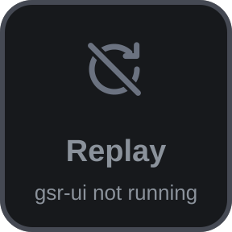 | off · filling (bar = how much a save gets) · full · overlay not running |
| **Save Replay** | 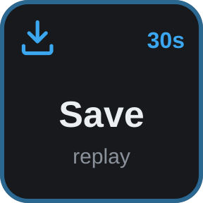 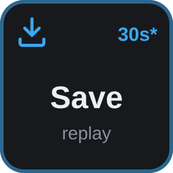 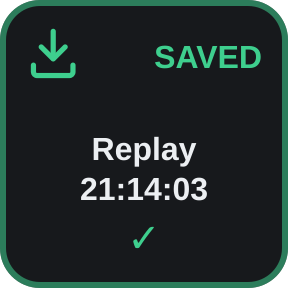 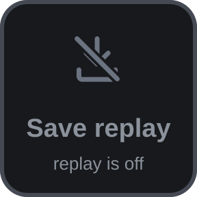 | ready · `*` = rounded to a signal length · just saved · replay off |
| **Save Section** | 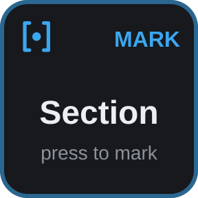 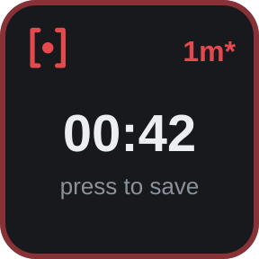 | no mark · marked (corner = what a save gives) |
| **Record** | 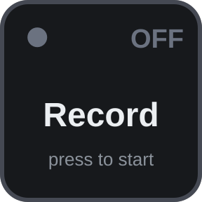 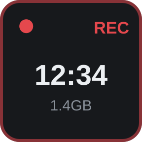 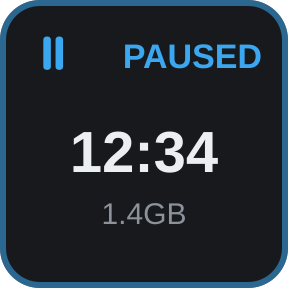 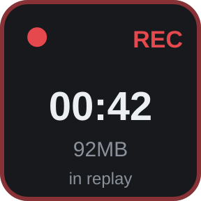 | idle · recording · paused · recording inside a replay |
| **Stream** | 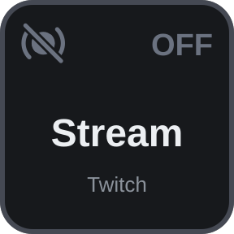 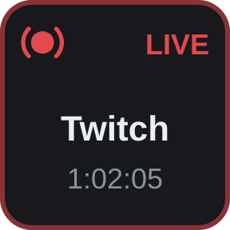 | idle · live |
| **Screenshot** | 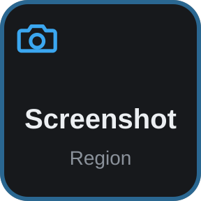 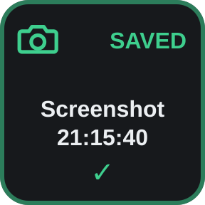 | ready · just saved |
| **Status** | 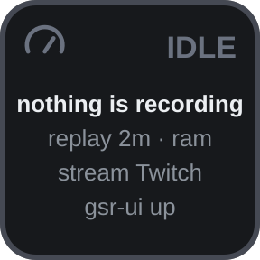 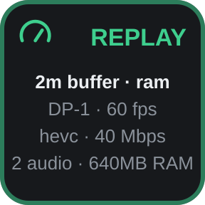 | idle · replay running |

These are drawn by the plugin's own renderer (`make preview`), not mocked up.

### Dials (Stream Deck+)

Replay, Save Replay, Save Section and Record also go on a dial. Each one draws
its whole segment of the touch strip.

| Dial | Turn | Press | Tap the strip |
| --- | --- | --- | --- |
| **Replay** | Step through recent saves, newest first; turn back past the newest to leave | Start or stop the replay | Show the newest save; while browsing, open the one shown |
| **Save Replay** | Choose how much to save (kept, like the inspector setting) | Save | Save |
| **Save Section** | Move the mark: left is further back, right is closer to now. Left with no mark drops one in the past; right past now removes it | Mark, then save from the mark to now | Throw the mark away |
| **Record** | Left pauses, right resumes | Start or stop, whatever the key's press setting is | Start or stop |

| Dial | Strip |
| --- | --- |
| **Replay** | 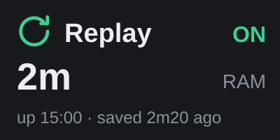 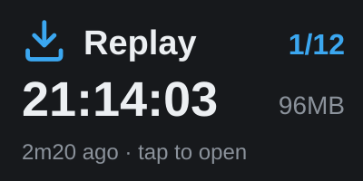 |
| **Save Replay** | 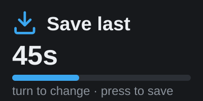 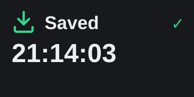 |
| **Save Section** | 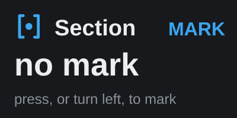 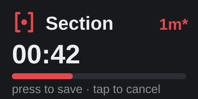 |
| **Record** | 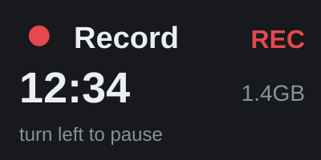 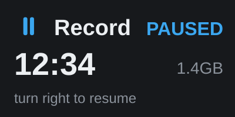 |

A section always **ends now**. The recorder can only save "the last N
seconds", so a window that ends in the past would mean cutting a saved file
afterwards. Without an IPC socket a section is rounded **up** to the next
signal length (10s, 30s, 1m, 5m, 10m, 30m), so the mark is always inside the
clip. A section longer than the buffer saves the whole buffer and the strip
says `buffer limit`.

With a socket the Save dial turns in fine steps (5s, 10s, 15s, 20s, 30s, 45s,
1m, 1m30…). Without one it steps through the signal lengths only, so it never
lands on a length it would have to round. Lengths longer than the buffer are
left out either way.

## How it talks to the recorder

There is no status request in GPU Screen Recorder's protocol, so state is read
from `/proc`: the command line gives the mode, buffer length, capture target,
frame rate, codec and bitrate; an open write-only file descriptor is what says
a recording is actually running; the process start time gives its age.

Control uses whichever of three routes exists, in this order:

1. **The IPC socket**, when the recorder was started with `-ipc`. The only one
   that saves an arbitrary number of seconds and the only one that reports the
   path of the file it wrote.
2. **Signals**, which every recorder accepts. Six fixed replay lengths and no
   reply, so a save is confirmed by watching the output directory. A key set to
   a length the signals cannot express shows it rounded, marked `*`.
3. **`gsr-ui-cli`**, which asks the overlay to start or stop something.

Starting anything goes through the overlay deliberately. Which monitor, which
codec, which audio tracks and where files land are chosen in GPU Screen
Recorder's own UI; a deck holding a second, disagreeing copy of that is how you
end up streaming to the wrong account or recording the wrong screen.

`gsr-ui` does not pass `-ipc` to the recorders it spawns, so on a machine using
the overlay saves go by signal today. The socket is preferred whenever one
exists, so a hand-started recorder gets the better behaviour with no change
here.

### What it cannot see

Two things are not readable from outside the recorder and are not guessed at:
whether a recording is **paused** (a Record key set to pause shows what it last
asked for, and a pause from a hotkey will disagree until the key is pressed
again), and which service a stream goes to when the URL is a custom one — that
comes from the config file instead.

## Requirements

| Dependency | Needed for | Notes |
| --- | --- | --- |
| Linux | everything | State comes from `/proc`; no other platform has it |
| [OpenDeck](https://github.com/nekename/OpenDeck) 2.14+ | everything | AppImage, native package or Flathub. Under Flatpak the plugin moves itself out of the sandbox with `flatpak-spawn --host`, which needs the `org.freedesktop.Flatpak` permission the Flathub build already has |
| `python3` 3.10+ at `/usr/bin/python3` | everything | The system interpreter. Standard library only, so there is nothing to `pip install` |
| [`gpu-screen-recorder`](https://git.dec05eba.com/gpu-screen-recorder/about/) | everything | The recorder the keys read and control |
| [`gpu-screen-recorder-ui`](https://git.dec05eba.com/gpu-screen-recorder-ui/about/) | starting replay, record, stream, screenshot | Provides `gsr-ui-cli`. The Flathub app (`com.dec05eba.gpu_screen_recorder`) works too: its CLI is run with `flatpak run`. Without it the deck can still save, stop and report on a running recorder |

Tested with `gpu-screen-recorder` 6.1.3 and `gpu-screen-recorder-ui` 1.13.10.

Install the recorder and overlay from your distribution:

```sh
# Arch / CachyOS / Manjaro
sudo pacman -S gpu-screen-recorder gpu-screen-recorder-ui
```

Other distributions: follow the
[upstream install instructions](https://git.dec05eba.com/gpu-screen-recorder/about/).

## Install

### From a release

1. Download `gpu-screen-recorder-opendeck-X.Y.Z.zip` from the
   [latest release](https://github.com/NyleGarcia/gpu-screen-recorder-opendeck/releases/latest).
   Check it against the `.sha256` file next to it with `sha256sum -c`.
2. Install it with OpenDeck's install-from-file option in the Plugins view, or
   by hand:
   ```sh
   unzip gpu-screen-recorder-opendeck-*.zip -d ~/.config/opendeck/plugins/
   ```
3. Restart OpenDeck and drag an action from **GPU Screen Recorder** onto a key.

### From source

```sh
git clone https://github.com/NyleGarcia/gpu-screen-recorder-opendeck.git
cd gpu-screen-recorder-opendeck
make install     # copies the bundle into ~/.config/opendeck/plugins
```

Then restart OpenDeck. It is a copy, not a symlink, so run `make install`
again after each change. To build the archive OpenDeck's installer takes:

```sh
make package     # dist/gpu-screen-recorder-opendeck-<version>.zip (+ .sha256)
```

### Uninstall

```sh
rm -rf ~/.config/opendeck/plugins/systems.garcia.gsr.sdPlugin
```

## Troubleshooting

**Every key says `gsr-ui not running`.** Starting anything goes through the
overlay, so `gpu-screen-recorder-ui` has to be installed and running. Check
that `gsr-ui-cli` is in `/usr/bin` or `~/.local/bin`, or that the Flathub
app `com.dec05eba.gpu_screen_recorder` is installed. The plugin runs with
exactly that `PATH`, not your shell's. Save Replay still works without the
overlay while some recorder is running a replay.

**The keys never change, even when recording.** OpenDeck is probably running
as a Flatpak without the `org.freedesktop.Flatpak` permission, so the plugin
cannot leave the sandbox, which hides other processes in `/proc` and blocks
signals to them. Grant it back with
`flatpak override --user --talk-name=org.freedesktop.Flatpak me.amankhanna.opendeck`,
or use the AppImage or a native package.

**A save length shows a `*`.** The recorder has no IPC socket, so the save
goes by signal. Signals only support six fixed lengths, so the key shows the
nearest one. See [How it talks to the recorder](#how-it-talks-to-the-recorder).

**Where are the logs?** The plugin writes
`~/.config/opendeck/plugins/systems.garcia.gsr.sdPlugin/plugin.log`. Start OpenDeck with
`GSR_DECK_DEBUG=1` for more detail. OpenDeck keeps the plugin's own output in
`~/.local/share/opendeck/logs/plugins/systems.garcia.gsr.sdPlugin.log`.

## Development

```sh
make check       # bundle validation, byte-compile, and the test suite
make icons       # redraw the action icons from the key glyphs
make preview     # redraw the README images from the key renderer
```

The tests fabricate a `/proc` tree and stand up a real unix socket speaking the
real IPC protocol, so the whole suite runs with no deck, no GPU and no
recorder.

## Translations

The keys, the property inspectors and the action list follow OpenDeck's
language (Settings → Language), and fall back to English for a language with
no file. English and French are included.

Each language is one file in `systems.garcia.gsr.sdPlugin/lang/`, named by its
code (`en.json`, `fr.json`). The file is in the layout OpenDeck reads for a
plugin's translations: the plugin's and each action's `Name` and `Tooltip` at
the top level, and every string the plugin draws under `Localization`.
`make install` and the release zip copy the files next to `manifest.json`,
where OpenDeck looks for them.

### Adding a language

1. Find the code OpenDeck uses for the language (`de`, `es`, `pt_BR`, ...).
   A region with no file of its own uses its base language, so `fr_FR` picks
   `fr.json`.
2. Copy the English file, which is the reference every other language is
   checked against:

   ```sh
   cd systems.garcia.gsr.sdPlugin/lang
   cp en.json de.json
   ```

3. Translate the values and leave every key as it is:
   - `Name` and `Description` at the top, and the `Name` and `Tooltip` of each
     `systems.garcia.gsr.*` action, are what OpenDeck shows in its action
     list.
   - `Localization` holds everything the plugin draws. `key.*` is the text on
     the keys, `pi.*` the property inspectors and `theme.*` the theme names.
   - Keep `{placeholders}` such as `{length}` or `{clock}` spelled exactly as
     in English. They may move within the sentence.
   - Keys are 144 px wide. Keep `key.*` strings about as short as the English
     ones; corner labels (`key.off`, `key.rec`, `key.saved`) have the least
     room.
4. Run `make check`. It fails on a missing or extra key, a placeholder that
   differs from `en.json`, an action without a `Name` and `Tooltip`, and
   invalid JSON.
5. Run `make install`, restart OpenDeck, set its language (Settings →
   Language) and look at every key state on a deck. `plugin.log` has a
   `language: <code>` line that says which file was picked.
6. Open a pull request with the new `lang/<code>.json`. No code needs to
   change: the plugin lists `lang/` at startup.

To fix a string in an existing language, edit its file and run `make check`.
To add a new string to the plugin, add the key to `en.json` and to every other
language file, then use it with `t("key.name")` in Python, `data-i18n="pi.name"`
in an inspector's HTML or `GSR.t("pi.name", "English fallback")` in its script.
A key missing from a language shows the English text, and a key missing from
English shows the key itself.

## Layout

```
systems.garcia.gsr.sdPlugin/
  manifest.json      the actions OpenDeck offers
  run.sh             launcher; scrubs the AppImage's Python environment
  plugin.py          the event loop and one renderer per action
  gsrdeck/
    state.py         what the recorder is doing, read from /proc
    control.py       the three ways to drive it
    config.py        GPU Screen Recorder's own settings, read-only
    render.py        the key and touch-strip art
    i18n.py          picks a language and looks its strings up
    ws.py            a minimal RFC 6455 client
  layouts/strip.json the dial layout: one full-strip pixmap
  pi/                property inspectors
  lang/              one translation file per language
```

## Credits

- [MrBretze](https://github.com/MrBretze) built the translation system and the
  French translation
  ([#3](https://github.com/NyleGarcia/gpu-screen-recorder-opendeck/pull/3)),
  and added support for OpenDeck and GPU Screen Recorder installed from
  Flathub
  ([#2](https://github.com/NyleGarcia/gpu-screen-recorder-opendeck/pull/2)).

## License

MIT — see [LICENSE](LICENSE).

The plugin drives GPU Screen Recorder as a separate process, through its IPC
socket, signals and `gsr-ui-cli`, and contains none of its code, so it is not a
derivative work of it and is not bound by its GPL.
